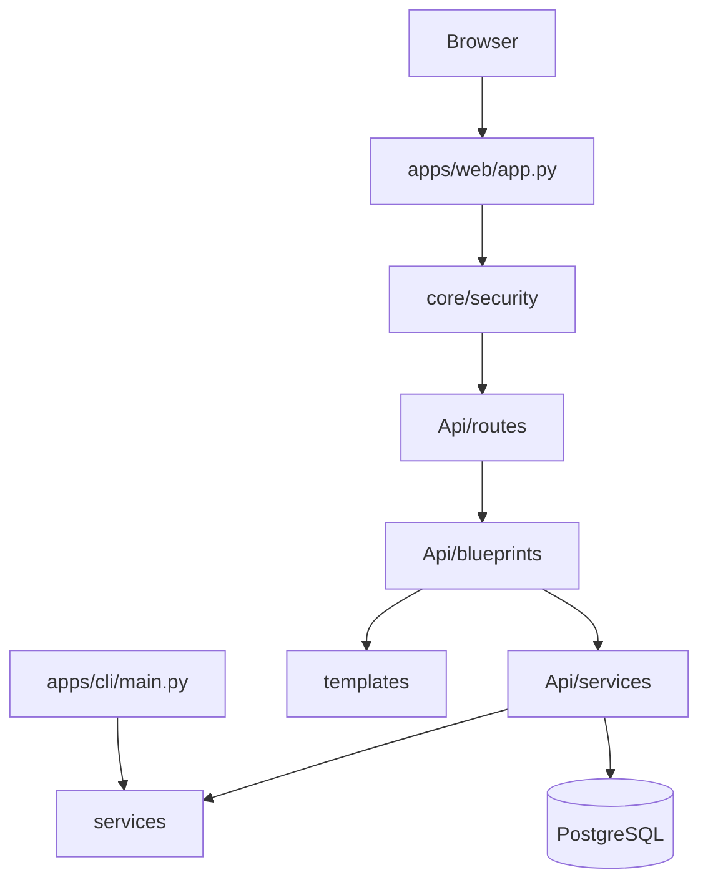
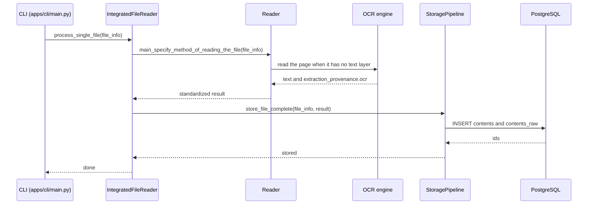
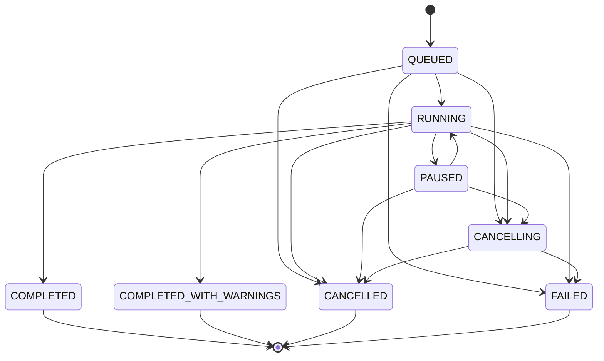

# Architecture

How SYLTHARAE is put together, what each layer is allowed to know, and how a
file travels from disk to a searchable row.

This document is checked. `tests/unit/test_architecture_claims.py` re-derives
every checkable sentence here from the code — the paths, the layer rules, the
method names in the diagrams, the job-state transitions. A sentence that drifts
fails there, and the fix is to correct this document, never the test.
`tests/unit/test_architecture_diagrams.py` does the same for the job-state
diagram. Claims that cannot be checked from the code are collected in
[Unverified claims](#unverified-claims) at the end rather than being quietly
presented as fact.

## Layers

| Layer | Owns | May know about |
|---|---|---|
| `apps/web` | Application factory, serving, deployment | Everything below it |
| `Api/routes` | HTTP: validate input, authorize, call a service, shape the response | `Api/services`, `Api/utils` |
| `Api/blueprints` | Server-rendered pages | `Api/services`, `templates` |
| `Api/services` | Orchestration per HTTP surface | `services` |
| `services` | Domain logic and invariants: ingestion, jobs, detection, reporting, geo, retention, scheduling | `core`, `pipeline`, `database` |
| `pipeline` | Read, extract, checkpoint, report progress | `reader_file`, `core` |
| `reader_file/readers` | One file format each | `core` |
| `core` | Foundation: security, search, OCR, registries, analytics | `core` only |
| `templates` | Presentation | Nothing; no access decisions |

The `templates` row is enforced by absence, not by a macro: no template decides
authorization.

### Rules that hold

Three rules are measured on every run, and they hold with no exceptions:

- **Readers must not import the database.** A reader returns a result; it does
  not persist one.
- **Routes must not import a reader directly.** A request never reads a file —
  ingestion is a job, so no request path contains a reader.
- **The pipeline must not call OCR itself.** OCR is invoked by the readers that
  need it, and only by them.

### Exceptions

Two rules have known breaches. They are pinned by name and by count, so a new
import into any of these files — or a new file at all — fails the test.

| `core/monitoring/notification_display.py` | `Api` | 1 |
| `core/monitoring/notification_service.py` | `Api` | 6 |
| `core/search/retrieval.py` | `Api` | 1 |
| `core/search/session.py` | `Api` | 1 |
| `core/search/words.py` | `Api` | 1 |
| `Api/routes/analysis.py` | `pipeline` | 2 |

The `core` breaches are all `core -> Api` and all in monitoring and search;
`Api/routes/analysis.py` reaches into `pipeline` for synchronous analysis. Both
are debts to be paid, not patterns to copy.

## Ingestion: one file, end to end

Points worth reading twice:

- The reader calls OCR, not the pipeline. Only `reader_file/readers/read_img_fast.py`
  and `reader_file/readers/read_pdf.py` import `core.ocr`, and `pipeline` does
  not import it at all.
- Storage is a single call into the pipeline. The pipeline owns the write, the
  provenance (`_ocr_provenance`) and the outcome record; the reader does not
  open a transaction.
- `contents` holds text for search and `contents_raw` holds the verbatim
  extraction. They are written together and are not interchangeable.

## Job lifecycle

`CANCELLING` exists because cancellation is cooperative: a job is asked to stop
at a safe boundary and reports back `CANCELLED`. There is no edge from
`CANCELLING` straight to `COMPLETED`, and no path back from a terminal state —
a finished job is finished.

## Interfaces

Three surfaces over the same services: server-rendered pages
(`templates`, `Api/blueprints`), a JSON REST API with SSE progress streams
(`Api/routes`), and a CLI (`apps/cli/main.py`). Routes validate and authorize;
services own the invariants. Nothing in `core/search` or `core/security` knows
which surface called it.

## Durability

Ingestion is crash-safe by journalling, not by rewriting state: every processed
file appends one identifier to an fsynced journal, and the snapshot is rewritten
only at a compaction point or at the end of a run. A run interrupted at any
point resumes from the last journalled file. See
[`resume-and-checkpoints.md`](resume-and-checkpoints.md).

## Unverified claims

Stated here because they are not checkable from the code, so nothing in the
tests above should be read as confirming them:

- **Performance and capacity.** No benchmark numbers are asserted anywhere.
  Real throughput depends on corpus composition, PostgreSQL tuning, OCR load
  and hardware.
- **Intended users.** The three roles (`analyst`, `admin`, `viewer`) are
  inferred from the permission model, not from a study of who actually uses the
  platform.
- **Deployment topology.** Reverse-proxy and multi-instance behaviour follows
  from `TRUSTED_PROXY_COUNT` and the single-process design, but no specific
  production topology is endorsed here.
- **OCR accuracy.** That OCR output is *good enough* for a given corpus is a
  judgement about the corpus and the language packs, not a property of the code.

---

Reviewed by: the repository owner. Corrections to a checkable sentence belong
in `tests/unit/test_architecture_claims.py` first, then here.
